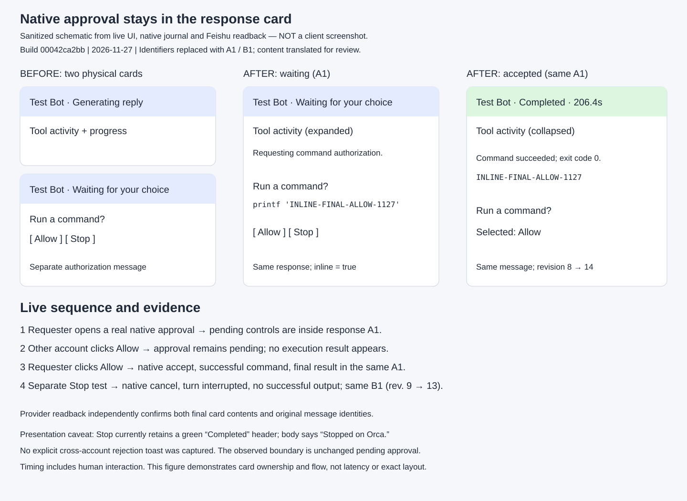

# Feishu inline native approval acceptance

**Checkpoint:** `00042ca2bbf08fbf81bf1e820ad417faed1254d0`  
**Date:** 2026-11-27 (Asia/Shanghai)  
**Scope:** local CLI Feishu connection, isolated macOS development profile, real Codex command approvals, private group with two user-owned accounts.

The figure is a **sanitized schematic reconstructed from observed UI and actual journal/provider data**, with translated labels. It is not an original Feishu screenshot, video, or a pixel-perfect rendering. The before panel illustrates the previously observed two-card defect. No real account names, chat/message identifiers, group sidebar, screenshots containing watermarks, credentials, or unrelated conversations are published.

## Live results

| Test | Observation | Result |
| --- | --- | --- |
| Native approval creation | The Agent called real `exec_command` with `sandbox_permissions=require_escalated` for a harmless `printf`. Native journal contained a pending approval with `accept` / `cancel`; it was not a simulated choice question. | ✅ |
| Same-card waiting | Progress, tool activity, command approval and Allow/Stop were visible inside response A1. The logical prompt had `inline=true` and no separate physical message. | ✅ |
| Different-account click | Switched to the other user-owned Feishu account and clicked Allow. After the spinner settled, controls remained available and the native approval remained pending, with no successful command output. No explicit rejection toast or per-click server audit was captured. | ✅ observed non-resolution; not a claim about rejection feedback |
| Requester Allow | Switched back to the requester and clicked Allow. Native resolution became `accept`; turn completed successfully and the command returned exit code 0 and `INLINE-FINAL-ALLOW-1127`. | ✅ |
| Allow final ownership | Final response, selected Allow and folded activity remained in A1. Original physical message identity was unchanged; revision 8 → 14, all revisions sent. | ✅ |
| Requester Stop | A separate native approval was stopped by the requester. Native resolution became `cancel`; turn was interrupted with outcome `cancellation`, with no successful command output or retry. | ✅ |
| Stop final ownership | Stop result and selected Stop remained in B1. Original physical message identity was unchanged; revision 9 → 13, all revisions sent. | ✅ |
| Independent provider verification | Bot-authenticated Feishu message reads returned both original interactive message IDs with the expected final content and selection; both were updated and not deleted. | ✅ |
| Cleanup | Restored the exact saved Bot permission mode. Proxy settings unchanged; no unrelated group member contacted. | ✅ |

A1 and B1 are stable pseudonyms for two distinct physical message IDs. The private raw records were compared before identifiers were removed. [Sanitized evidence.json](evidence.json) includes native state samples and final provider-returned content. It is a selected evidence extract, not a full callback audit or complete session dump.

## Remaining presentation caveat

After Stop, the actual card header still says **已完成** (Completed), its tool row says **失败** (Failed), and its body says **Stopped on Orca.** The native cancellation and same-card delivery passed; a distinct cancelled/stopped header has not been implemented or claimed. The schematic and extract deliberately retain this fact.

Elapsed values (206.4 s and 84.8 s in provider headers) include time waiting for manual account switching and approval. They are not model, network, or adapter latency benchmarks.

## Reproduction

1. Use a disposable CLI-connected Bot/profile and a private group with a requester and another authorized test account. Save the Bot's permission mode, temporarily require native approval, and restore it afterward.
2. Ask the Agent to make a real escalated command call that only prints a unique marker. Explicitly forbid file changes, workers, retries, and simulated choice prompts.
3. Verify a pending native approval and that its controls are in the response card; record that card's physical message ID.
4. Click Allow from the second account. Verify the native approval is still pending and the command has not succeeded. Then click Allow from the requester and verify native success and the marker in the same card.
5. Repeat with a new marker and choose Stop. Verify native cancellation, no successful command output/retry, and termination on that test's original card.
6. Independently fetch both messages from Feishu, compare message identities and final contents, and restore the saved permission mode.

## Validation boundary

This acceptance did not change implementation code. The existing checkpoint gate passed 54 selected checks against main `19dd83585e`; it was not rerun just to publish these materials. Broader platform, transport, race and attachment coverage remains as qualified in PR #49809. Earlier model-routing failures occurred before tool invocation; these fresh requests reached and exercised the native approval flow, without a new proxy core or a proxy configuration change.
